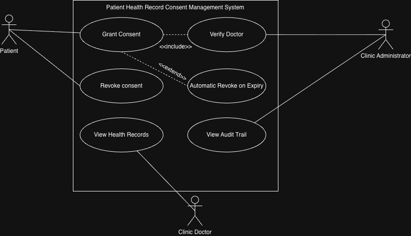

# Lab 1: Requirements Engineering & UML Use-Case Modelling

## Problem Statement #13: Patient Health Record Consent Management System

## Requirements Table

| ID | Type | Description | Priority | Acceptance Criteria | Rationale |
|---|---|---|---|---|---|
| FR-001 | Functional | The system shall allow patients to grant time-bounded access permissions for specific diagnostic records to verified clinic doctors. | High | Pass: Clinic access is granted for the specified duration and automatically revoked when the consent expires. Fail: Access continues after the expiry time. | Allows patients to control who can access their medical records and for how long. |
| FR-002 | Functional | The system shall allow patients to revoke previously granted consent before its expiry. | High | Pass: Access to the selected records is removed immediately after consent is revoked. Fail: The doctor can still access the records after revocation. | Gives patients direct control over previously granted permissions. |
| FR-003 | Functional | The system shall automatically revoke access when a patient's consent reaches its expiry time. | High | Pass: Access is automatically denied after the consent expiry timestamp. Fail: Access remains available after the expiry timestamp. | Prevents healthcare providers from retaining access beyond the period authorized by the patient. |
| FR-004 | Functional | The system shall allow authorized clinic doctors to access patient health records when valid consent exists. | High | Pass: A doctor with valid consent can access the permitted records. Fail: A doctor without valid consent can access the records. | Enables legitimate healthcare access while respecting patient consent. |
| FR-005 | Functional | The system shall allow the clinic administrator to verify doctors before they are granted access to patient health records. | Medium | Pass: Only verified doctors can receive patient-record access. Fail: An unverified doctor receives access. | Helps prevent unauthorized healthcare personnel from accessing patient information. |
| NFR-001 | Performance & Security | All consent grant, revoke, and access events shall be permanently written to an append-only audit trail. | High | Pass: All required events are recorded and cannot be modified. Fail: An event is missing or an existing audit record can be altered. | Provides accountability and supports detection and investigation of unauthorized access. |
| NFR-002 | Security | Patient health records shall be accessible only to authorized users with valid consent. | High | Pass: Unauthorized access attempts are denied. Fail: An unauthorized user is able to access patient health records. | Protects sensitive patient health information from unauthorized access. |

## UML Use-Case Diagram

## Use-Case Flow Specification

### Use Case: Grant Consent

**Preconditions**
- The patient is registered and logged in.
- The clinic doctor is present in the system.
- The clinic doctor has been verified by the clinic administrator.

**Main Success Scenario**
1. The patient selects Grant Consent.
2. The patient selects the health records to be shared.
3. The patient selects a verified clinic doctor.
4. The patient specifies the consent duration.
5. The system verifies that the selected doctor is authorized.
6. The system grants the doctor access to the selected health records.
7. The system records the consent-grant event in the audit trail.
8. The system automatically revokes access when the consent expires.

**Alternate Flow**
- If the selected doctor is not verified, the system denies the consent request and does not grant access to the health records.

**Postconditions**
- The consent is recorded successfully.
- The authorized doctor has access to the permitted records for the specified duration.
- The consent event is recorded in the audit trail.
- Access is revoked when the consent expires.
